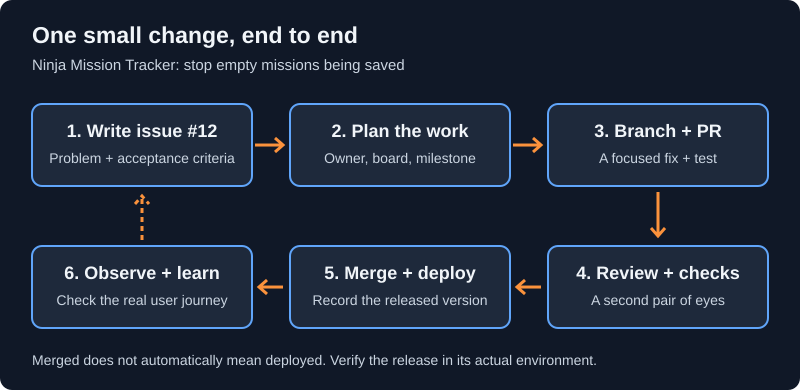

# Git & GitHub: From First Commit to Team Workflows

A free, beginner-friendly tutorial using Naruto, Sasuke, and Sakura's Ninja Mission Tracker to explain Git and GitHub through practical examples.

## Start learning

Open [`index.html`](index.html) in a browser, or serve this folder with a local static server such as VS Code Live Server. No build or dependency installation is required. Fonts and icons use external CDNs; lesson text and workflow diagrams are stored locally.

## Learning paths

- **Foundations:** setup, commits, staging, branches, merging, conflicts, remotes, and GitHub collaboration.
- **Advanced Git:** stash and rebase.
- **Production workflows:** issues, GitHub Projects, milestones, repository structure, reviews, automated checks, releases, and recovery.
- **Open source:** finding a suitable project, making a first contribution, growing into maintenance, and preparing for Hacktoberfest using current official guidance.
- **Hackathons:** setup, prioritization, collaboration, integration, demos, and judge-ready submissions.
- **Practice:** real-world problem labs and a command cheatsheet.

Each new practical lesson includes common problems, safe resolutions, and an exercise. Examples describe workflows; they do not configure production infrastructure or add real credentials.



## Repository layout

```text
index.html                    Tutorial, navigation, search, and original styles
assets/
  css/learning-paths.css       Practical lesson styles
  images/workflows/           Original, accessible SVG diagrams
naruto.jpg                    Existing story illustrations
sasuke.jpg
sakura.jpg
```

The tutorial remains a single-page static site. Its sections are grouped in the sidebar, included in search, and connected by previous/next lesson navigation. New visuals are original diagrams, not third-party screenshots.

## Notes

- Example repository names, issue numbers, file paths, and terminal placeholders must be adapted to your project.
- Practice destructive or recovery operations only in a disposable repository, not someone else's project or production environment.
- Event rules change. The Hacktoberfest lesson references the official 2026 format, checked November 3, 2026; verify the current edition before participating.
- New lessons link to GitHub documentation, Open Source Guides, and the official Hacktoberfest website.

## Content checks

With Node.js installed, run `node --test tests/tutorial.test.cjs` to check lesson mappings, sidebar order, local assets, unique IDs, and the required practical lesson sections.

Created by [Nirmal Kharal](https://github.com/kharalnirmal).
